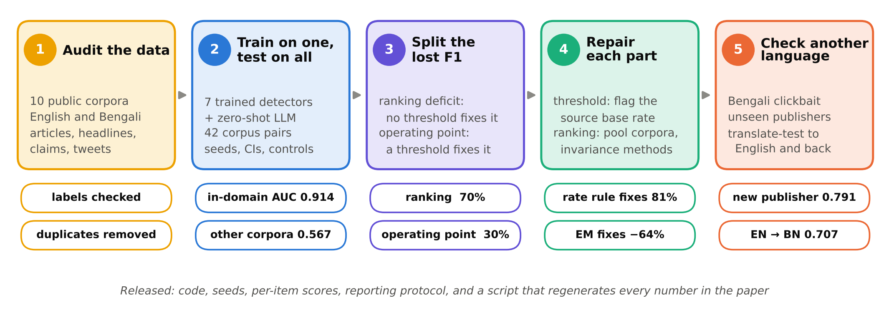
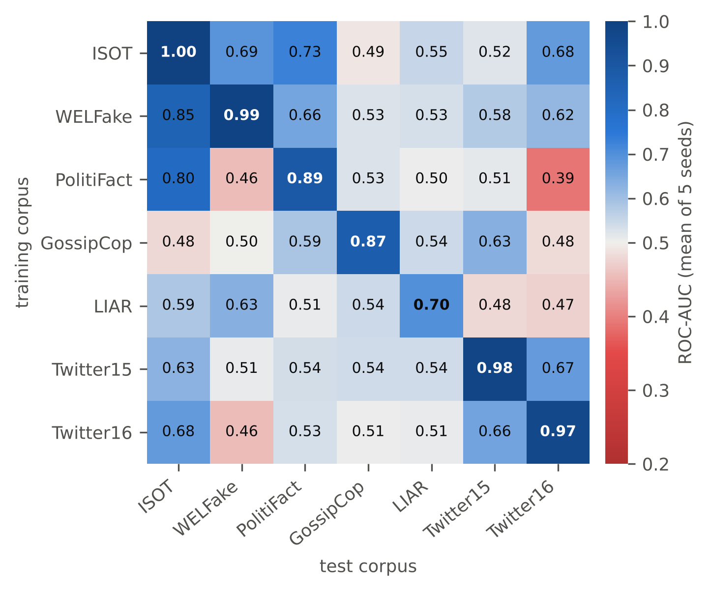
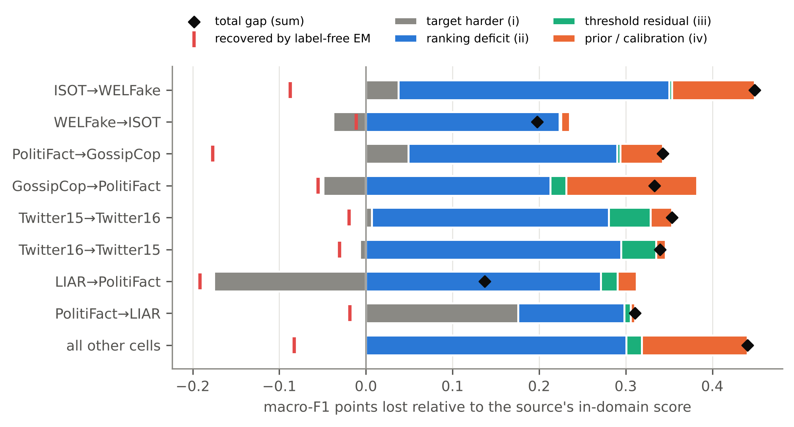
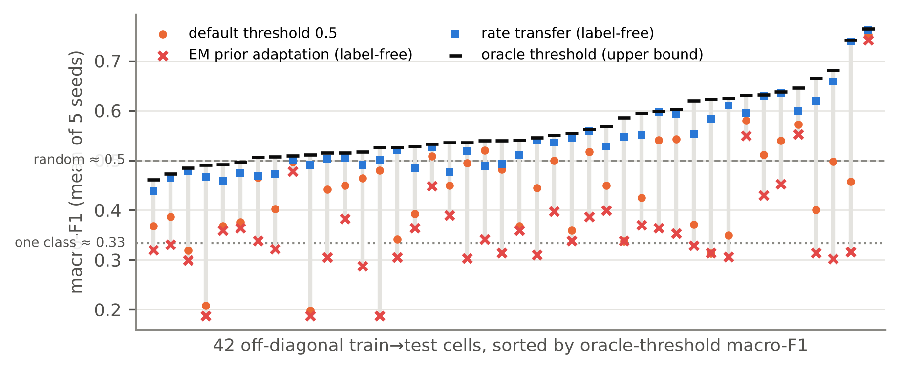
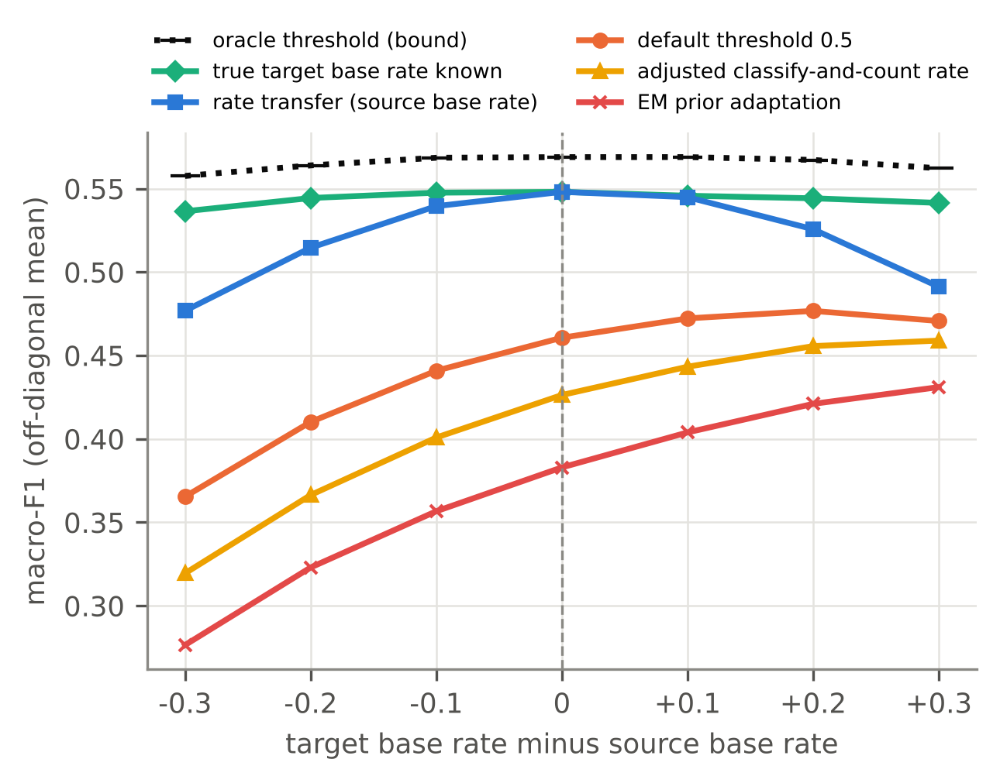

<p align="center">
  
</p>

<p align="center">
  <a href="LICENSE"></a>
  
  
  
  
</p>

<h3 align="center">Mostly ranking, partly threshold</h3>
<p align="center"><em>Decomposing and repairing the cross-corpus generalisation gap of misinformation detectors</em></p>
<p align="center">
  <b>Dewan Fahad Chowdhury</b><sup>*</sup> · <b>Md. Rejaul Korim Sadi</b><sup>*</sup><br>
  Department of Computer Science and Engineering, Metropolitan University, Sylhet, Bangladesh<br>
  <sub><sup>*</sup>Equal contribution, joint first authors.</sub>
</p>

---

## In one paragraph

Fake-news detectors score above 95% on the corpus they were trained on and much worse on other corpora. We ask **why**, in a way that tells you what to fix. Across ten public corpora (two languages; articles, headlines, claims and tweets) and seven detectors, from TF-IDF to a fine-tuned RoBERTa, we split the macro-F1 a detector loses on a new corpus into a **ranking deficit**, which no decision threshold can recover, and an **operating-point loss**, which the right threshold would. About **{{RankShareAll}}** of the gap is ranking (95% corpus-bootstrap interval {{RankShareCI}}) and **{{OpShareAll}}** is the operating point. The textbook label-shift fix (EM prior adaptation) makes the operating point *worse* ({{RecEM}} of the loss recovered). Flagging new items at the source base rate, **rate transfer**, recovers **{{RecRank}}** without a single target label. The paper shows when that rule is exact and how it degrades once the base rate itself moves.

## Key results

| | |
|---|---|
| In-domain ROC-AUC (TF-IDF + LR, mean of 7 corpora) | **{{InAUC}}** |
| Transfer ROC-AUC, all 42 off-diagonal cells | **{{OffAUC}}** |
| Transfer ROC-AUC, 8 same-task cells | **{{PairAUC}}** |
| Permutation control, transfer AUC | {{PermAUC}} ± {{PermAUCsd}} |
| Off-diagonal cells with AUC < 0.5 (cue reversed) | {{NcellsBelowHalf}} of 42 |
| Share of the F1 gap that is **ranking** (corpus bootstrap) | **{{RankShareAll}}** {{RankShareCI}} |
| … with balanced accuracy instead of macro-F1 | {{BARankShare}} |
| Operating-point loss recovered by EM prior adaptation | {{RecEM}} |
| … by **rate transfer** (label-free) | **{{RecRank}}** {{RecRankCI}} |
| … by flagging exactly half of the items | {{RecHalf}} |
| … by knowing the true target base rate | {{RecPrior}} |
| Calibration error in-domain → on a new corpus (ECE) | {{ECEin}} → {{ECEout}} |
| Frozen RoBERTa vs TF-IDF transfer AUC (same subsets) | {{RobOffAUC}} vs {{SubLROffAUC}} |
| Fine-tuned RoBERTa vs TF-IDF transfer AUC (same subsets) | {{FTOffAUC}} vs {{FTsubOffAUC}} |
| Zero-shot LLM (Qwen3-0.6B) AUC on the same items, no training | {{LLMauc}} |
| … its macro-F1 with its own answer → flagging half the items | {{LLMFdef}} → {{LLMFhalf}} |
| Held-out AUC: pooled LR vs EANN / MDFEND / ENDEF re-implementations | {{DGERMlr}} vs {{DGEANN}} / {{DGMDFEND}} / {{DGENDEF}} |
| Held-out AUC, pooled training on 6 corpora vs one corpus | {{LocoPooled}} vs {{LocoMeanSingle}} |
| … with corpus identity projected out (INLP) | {{LocoINLP}} |
| Bengali clickbait: leave-one-publisher-out AUC | {{BBlosoAUC}} |
| English → Bengali clickbait (translate-test) AUC | {{XlENtoBB}} |

<p align="center">
  
</p>
<p align="center">
  
  &nbsp;
  
</p>
<p align="center">
  
  &nbsp;
  
</p>

## The decomposition

For a model trained on corpus *A* and deployed on corpus *B*, with macro-F1 *F* at threshold τ:

```
F_BB(0.5) − F_AB(0.5)  =  [F_BB(0.5) − F_AB(τ*)]      ranking deficit      (no threshold can fix)
                        + [F_AB(τ*)  − F_AB(τ_π)]     threshold residual
                        + [F_AB(τ_π) − F_AB(0.5)]     prior / calibration  (a threshold can fix)
```

τ\* is the oracle threshold on *B*, τ_π the threshold whose predicted-positive rate equals *B*'s true base rate.

**Rate transfer**, the label-free repair:

```python
t = np.quantile(scores_on_new_corpus, 1 - source_base_rate)   # flag the source's base rate of items
pred = scores_on_new_corpus >= t
```

It is exact when target scores are an order-preserving distortion of source scores and the base rate is unchanged (Proposition 1 in the paper). If you expect the base rate of your feed to differ, estimate it from a small labelled sample: neither EM nor adjusted classify-and-count could do it label-free on these corpora.

## What is in here

```
fn-transfer-audit/
├── src/
│   ├── prep.py            harmonise labels, MinHash dedup, cross-corpus overlap
│   ├── label_probe.py     verify label direction with outlet signatures
│   ├── provenance.py      rebuild the ISOT/WELFake working copies from the releases
│   ├── transfer.py        train-on-one / test-on-all, 5 models × 3 regimes × 5 seeds
│   ├── roberta.py         frozen RoBERTa-base representations (+ paired TF-IDF baseline)
│   ├── finetune.py        RoBERTa-base with the top 4 layers fine-tuned (+ paired TF-IDF)
│   ├── llm_zeroshot.py    zero-shot Qwen3-0.6B baseline on the same test items
│   ├── dg.py              EANN-, MDFEND- and ENDEF-style methods, leave-one-corpus-out
│   ├── mechanism.py       style/group/learning-curve/top-K/masking/topic/PAD probes
│   ├── fix.py             leave-one-corpus-out representation repairs
│   ├── bangla.py          BanglaBait replication, leave-one-publisher-out, translate-test
│   ├── analysis*.py       CIs, decomposition, operating points, robustness, tests
│   ├── verify_claims.py   re-derives the paper's claims from raw results and checks them
│   ├── figures*.py        every figure in the paper (with an automatic text-overlap check)
│   └── paper_numbers.py   every number in the paper (LaTeX macros) — nothing typed by hand
├── results/               per-cell CSVs, summaries, key_numbers.json
├── figures/               PDF + 300-dpi PNG
├── logs/                  run logs
├── DATA.md                sources, licences, label conventions, privacy
└── run_all.sh             one command, ~14–16 h on a 2-core CPU
```

## Reproduce

```bash
pip install -r requirements.txt
pip install https://github.com/explosion/spacy-models/releases/download/en_core_web_sm-3.8.0/en_core_web_sm-3.8.0-py3-none-any.whl
pip install https://github.com/explosion/spacy-models/releases/download/en_core_web_trf-3.8.0/en_core_web_trf-3.8.0-py3-none-any.whl
export DATA_DIR=/path/to/data      # layout in DATA.md
bash run_all.sh
```

Every random choice is seeded (0–4; 0–2 for fine-tuning). Saved per-item scores (`artifacts/preds/`, produced by the run) let you recompute any metric or threshold rule without retraining.

<details>
<summary><b>Reporting protocol we recommend</b></summary>

1. **Verify label direction** with signature probes; a same-task AUC below 0.5 is a data error until shown otherwise.
2. **Deduplicate** within and across corpora (near-duplicates), dropping label-conflicting groups.
3. Report at least one **same-task cross-corpus** result, with **AUC/AP** next to F1.
4. Report the **decomposition**: F1 at the default, prior-matched and (cross-fitted) oracle thresholds.
5. Run three cheap **shortcut probes**: surface-statistics style model, group-identity baseline, 64-example learning-curve point.
6. Add a **permutation control**, several seeds, and intervals that resample corpora when you average over a matrix.
7. **Deploy with a rate-based operating point** unless target labels exist; estimate the base rate from a labelled sample if it may have changed.

</details>

<details>
<summary><b>A note on label conventions</b></summary>

ISOT and the WELFake release both code `1 = fake`, but the WELFake record documents the opposite legend (`0 = fake, 1 = real`). Our working copy of WELFake was built from that legend, so every one of its labels is inverted, and `prep.py` inverts it back. `src/label_probe.py` checks the direction on the files: in the release, all {{WELrelNyt}} titles ending in "- The New York Times" carry label 0 and all {{WELrelFiv}} texts with "Featured image via" carry label 1. Reading WELFake through its legend makes ISOT↔WELFake transfer look below chance. `src/provenance.py` documents how both working copies were derived from the releases (see `DATA.md`).

</details>

## Citation

```bibtex
@misc{chowdhury_sadi_2026_ranking_threshold,
  title  = {Mostly ranking, partly threshold: decomposing and repairing the cross-corpus
            generalisation gap of misinformation detectors},
  author = {Chowdhury, Dewan Fahad and Sadi, Md. Rejaul Korim},
  year   = {2026},
  note   = {Equal contribution. Code: https://github.com/<account>/fn-transfer-audit}
}
```

## Licence

Code: MIT. Datasets keep their own licences (see [DATA.md](DATA.md)); no dataset text is redistributed.
