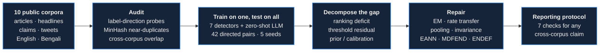
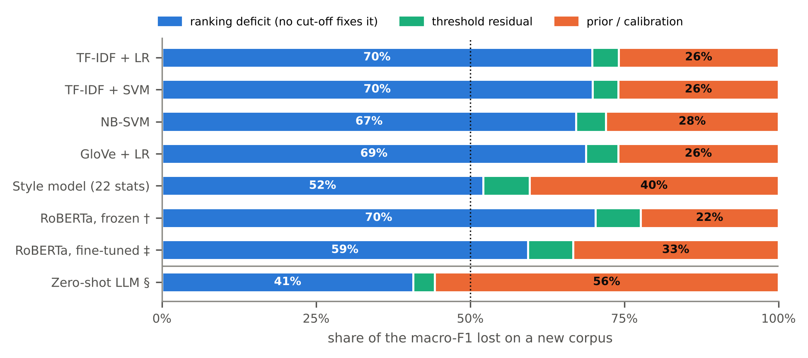
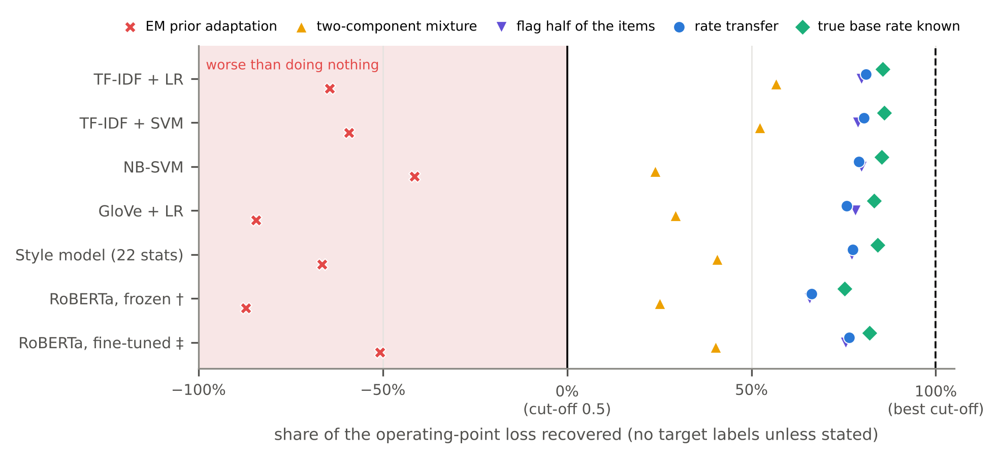
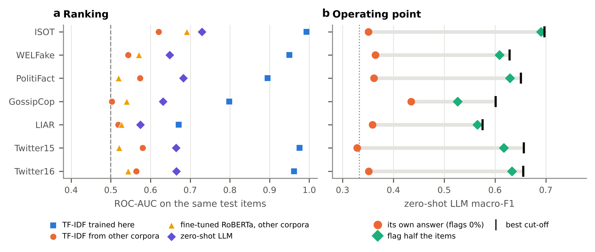
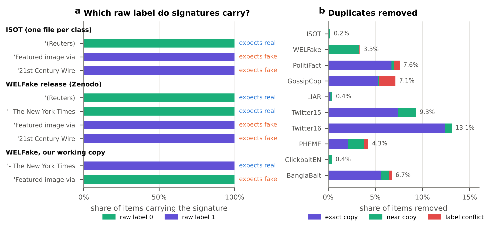

<p align="center">
  
</p>

<p align="center">
  <a href="paper/manuscript.pdf"></a>
  <a href="paper/supplementary.pdf"></a>
  <a href="LICENSE"></a>
  
  
  <a href="logs/verify_claims.log"></a>
</p>

<p align="center">
  <b>Dewan Fahad Chowdhury</b><sup>*</sup> &nbsp;·&nbsp; <b>Md. Rejaul Korim Sadi</b><sup>*</sup><br>
  Department of Computer Science and Engineering, Metropolitan University, Sylhet, Bangladesh<br>
  <sub><sup>*</sup>Equal contribution, joint first authors</sub>
</p>

<p align="center">
  <a href="#the-short-version">Short version</a> &nbsp;·&nbsp;
  <a href="#how-it-works">How it works</a> &nbsp;·&nbsp;
  <a href="#key-results">Key results</a> &nbsp;·&nbsp;
  <a href="#repository-map">Repository</a> &nbsp;·&nbsp;
  <a href="#reproduce">Reproduce</a> &nbsp;·&nbsp;
  <a href="#citation">Citation</a>
</p>

<br>

## The short version

Fake-news detectors score above 95% on the corpus they were trained on and far worse on any other. Accuracy and F1 hide *why*. A detector can fail on a new corpus in two ways: it can **rank** the new items badly, or rank them well and put the **threshold** in the wrong place. The first needs a better model. The second needs only a better cut-off.

We separate the two across ten public corpora (English and Bengali; articles, headlines, claims and tweets), seven detectors from TF-IDF to a fine-tuned RoBERTa, and a zero-shot language model.

<table align="center">
  <tr>
    <td align="center" width="25%"><h3>{{InAUC}} → {{OffAUC}}</h3>ROC-AUC in-domain → on a new corpus</td>
    <td align="center" width="25%"><h3>{{RankShareAll}}</h3>of the lost macro-F1 is <b>ranking</b><br>(interval {{RankShareCI}})</td>
    <td align="center" width="25%"><h3>{{RecEM}}</h3>of the threshold loss "recovered" by EM label-shift correction</td>
    <td align="center" width="25%"><h3>{{RecRank}}</h3>recovered by <b>rate transfer</b>,<br>with no target labels</td>
  </tr>
</table>

<p align="center">
  
</p>

> [!IMPORTANT]
> **Check your WELFake labels.** The WELFake release codes `1 = fake`, but its own documentation says `0 = fake`. Read through the documented legend, every label is inverted: in-domain scores look fine, and transfer to or from WELFake collapses below chance. See [the note below](#a-note-on-label-direction).

## How it works



For a model trained on corpus $A$ and deployed on corpus $B$, with macro-F1 $F$ at threshold $\tau$, the transfer gap splits into three parts:

```math
\underbrace{F_{BB}(0.5) - F_{AB}(0.5)}_{\text{transfer gap}}
= \underbrace{F_{BB}(0.5) - F_{AB}(\tau^{\star})}_{\text{ranking: no threshold fixes it}}
+ \underbrace{F_{AB}(\tau^{\star}) - F_{AB}(\tau_{\pi})}_{\text{threshold residual}}
+ \underbrace{F_{AB}(\tau_{\pi}) - F_{AB}(0.5)}_{\text{prior and calibration}}
```

$\tau^{\star}$ is the best threshold on $B$ (it needs labels) and $\tau_{\pi}$ the threshold that flags $B$ at its true base rate.

<p align="center">
  
</p>

**Rate transfer** is the label-free repair. It keeps the model's ranking and moves only the cut-off:

```python
import numpy as np

def rate_transfer(scores_on_new_corpus, source_base_rate):
    """Flag the same share of new items as the share of fakes in the training corpus."""
    t = np.quantile(scores_on_new_corpus, 1 - source_base_rate)
    return scores_on_new_corpus >= t
```

It is exact when the new scores are an order-preserving distortion of the old ones and the base rate is unchanged (Proposition 1 in the paper). When the base rate itself may have moved, estimate it from a small labelled sample: on these corpora, neither EM nor adjusted classify-and-count could do it without labels.

## Key results

| Result | Value |
|---|---|
| In-domain ROC-AUC (TF-IDF + LR, mean of 7 corpora) | **{{InAUC}}** |
| Transfer ROC-AUC, all 42 off-diagonal cells | **{{OffAUC}}** |
| Transfer ROC-AUC, 8 same-task cells | **{{PairAUC}}** |
| Permutation control, transfer AUC | {{PermAUC}} ± {{PermAUCsd}} |
| Off-diagonal cells with AUC < 0.5 (cue reversed) | {{NcellsBelowHalf}} of 42 |
| Share of the F1 gap that is **ranking** (corpus bootstrap) | **{{RankShareAll}}** {{RankShareCI}} |
| … with balanced accuracy instead of macro-F1 | {{BARankShare}} |
| Threshold loss recovered by EM prior adaptation | {{RecEM}} |
| … by **rate transfer** (no labels) | **{{RecRank}}** {{RecRankCI}} |
| … by flagging exactly half of the items | {{RecHalf}} |
| … by knowing the true target base rate | {{RecPrior}} |
| Calibration error in-domain → on a new corpus (ECE) | {{ECEin}} → {{ECEout}} |
| Frozen RoBERTa vs TF-IDF transfer AUC (same subsets) | {{RobOffAUC}} vs {{SubLROffAUC}} |
| Fine-tuned RoBERTa vs TF-IDF transfer AUC (same subsets) | {{FTOffAUC}} vs {{FTsubOffAUC}} |
| Zero-shot LLM (Qwen3-0.6B) AUC on the same items, no training | {{LLMauc}} |
| … its macro-F1 with its own answer → flagging half the items | {{LLMFdef}} → {{LLMFhalf}} |
| Held-out AUC: pooled LR vs EANN / MDFEND / ENDEF re-implementations | {{DGERMlr}} vs {{DGEANN}} / {{DGMDFEND}} / {{DGENDEF}} |
| Held-out AUC, pooled training on 6 corpora vs one corpus | {{LocoPooled}} vs {{LocoMeanSingle}} |
| … with corpus identity projected out (INLP) | {{LocoINLP}} |
| Bengali clickbait: leave-one-publisher-out AUC | {{BBlosoAUC}} |
| English → Bengali clickbait (translate-test) AUC | {{XlENtoBB}} |

<p align="center">
  
</p>

<details>
<summary><b>More figures</b> (transfer matrix, decomposition per pair, detectors, zero-shot LLM, prior shift)</summary>
<br>
<p align="center">
  
  &nbsp;
  
</p>
<p align="center">
  
  &nbsp;
  
</p>
<p align="center">
  
</p>
<p align="center">
  
  &nbsp;
  
</p>
<p align="center">
  
</p>
</details>

## Repository map

```
.
├── src/
│   ├── prep.py              harmonise labels, MinHash dedup, cross-corpus overlap
│   ├── label_probe.py       verify label direction with outlet signatures
│   ├── provenance.py        rebuild the ISOT and WELFake working copies from the releases
│   ├── transfer.py          train on one, test on all: 5 models × 3 regimes × 5 seeds
│   ├── roberta.py           frozen RoBERTa-base features (+ paired TF-IDF baseline)
│   ├── finetune.py          RoBERTa-base, top 4 layers fine-tuned (+ paired TF-IDF)
│   ├── llm_zeroshot.py      zero-shot Qwen3-0.6B on the same test items
│   ├── dg.py                EANN-, MDFEND- and ENDEF-style models, leave-one-corpus-out
│   ├── mechanism.py         style, group, learning-curve, top-K, masking, topic, PAD probes
│   ├── fix.py               leave-one-corpus-out representation repairs
│   ├── bangla.py            BanglaBait replication, leave-one-publisher-out, translate-test
│   ├── analysis*.py         intervals, decomposition, operating points, robustness, tests
│   ├── figures*.py          every figure, with an automatic text-overlap check
│   ├── paper_numbers.py     every number in the paper as a LaTeX macro (none typed by hand)
│   ├── verify_claims.py     re-derives the paper's claims from the raw results
│   └── readme_assets.py     the animated graphics on this page, drawn from the results
├── results/                 per-cell CSVs, summaries, key_numbers.json, provenance.json
├── figures/                 every figure as PDF and 300-dpi PNG
├── paper/                   LaTeX source, manuscript and supplement PDFs
├── logs/                    run logs
├── assets/                  README graphics
├── DATA.md                  sources, licences, label conventions, provenance, privacy
└── run_all.sh               the whole study in one command
```

## Reproduce

**Check the claims in a minute, no data needed.** The result files are in the repository, so the paper's claims can be re-derived straight away:

```bash
git clone https://github.com/RejaulKorimSadi/Decomposing-and-repairing-the-cross-corpus-generalisation-gap-of-misinformation-detectors.git
cd Decomposing-and-repairing-the-cross-corpus-generalisation-gap-of-misinformation-detectors
pip install numpy pandas            # all the check needs
python src/verify_claims.py          # {{VerifyBadge}} checks pass
```

**Rerun everything.** Get the corpora as described in [DATA.md](DATA.md), then:

```bash
pip install -r requirements.txt
pip install https://github.com/explosion/spacy-models/releases/download/en_core_web_sm-3.8.0/en_core_web_sm-3.8.0-py3-none-any.whl
pip install https://github.com/explosion/spacy-models/releases/download/en_core_web_trf-3.8.0/en_core_web_trf-3.8.0-py3-none-any.whl
export DATA_DIR=/path/to/data        # layout in DATA.md
bash run_all.sh                      # about 14 to 16 hours on a 2-core CPU, no GPU
```

Every random choice is seeded (0 to 4; 0 to 2 for fine-tuning). The run saves per-item scores in `artifacts/preds/`, so any metric or threshold rule can be recomputed without retraining; the same scores are attached to the GitHub release as `per_item_scores.tar.gz`.

<details>
<summary><b>The reporting protocol we recommend for cross-corpus claims</b></summary>
<br>

1. **Verify label direction** with signature probes. A same-task AUC below 0.5 is a data error until shown otherwise.
2. **Deduplicate** within and across corpora (near-duplicates too), and drop label-conflicting groups.
3. Report at least one **same-task cross-corpus** result, with **AUC or AP** next to F1.
4. Report the **decomposition**: F1 at the default, the prior-matched and the (cross-fitted) best threshold.
5. Run three cheap **shortcut probes**: a surface-statistics style model, a group-identity baseline and a 64-example learning-curve point.
6. Add a **permutation control**, several seeds, and intervals that resample corpora when you average over a matrix.
7. **Deploy with a rate-based operating point** unless target labels exist, and estimate the base rate from a labelled sample if it may have changed.

</details>

<details id="a-note-on-label-direction">
<summary><b>A note on label direction</b></summary>
<br>

ISOT and the WELFake release both code `1 = fake`, but the WELFake record documents the opposite legend (`0 = fake, 1 = real`). Our working copy of WELFake was built from that legend, so every one of its labels is inverted, and `prep.py` inverts it back. `src/label_probe.py` checks the direction on the files: in the release, all {{WELrelNyt}} titles ending in "- The New York Times" carry label 0 and all {{WELrelFiv}} texts with "Featured image via" carry label 1. Reading WELFake through its legend makes ISOT ↔ WELFake transfer look below chance. `src/provenance.py` documents how both working copies were derived from the releases (see [DATA.md](DATA.md)).

</details>

## Citation

```bibtex
@misc{chowdhury2026rank,
  title        = {Rank or threshold? Why fake-news detectors fail on new corpora},
  author       = {Chowdhury, Dewan Fahad and Sadi, Md. Rejaul Korim},
  year         = {2026},
  howpublished = {\url{https://github.com/RejaulKorimSadi/Decomposing-and-repairing-the-cross-corpus-generalisation-gap-of-misinformation-detectors}},
  note         = {Preprint. Equal contribution}
}
```

## Licence

The code is released under the [MIT licence](LICENSE). Every corpus keeps its own licence (see [DATA.md](DATA.md)), and no dataset text is redistributed here.

<p align="center"><sub>Questions or corrections: open an issue, or write to Dewan Fahad Chowdhury (dewanfahadc@gmail.com).</sub></p>
